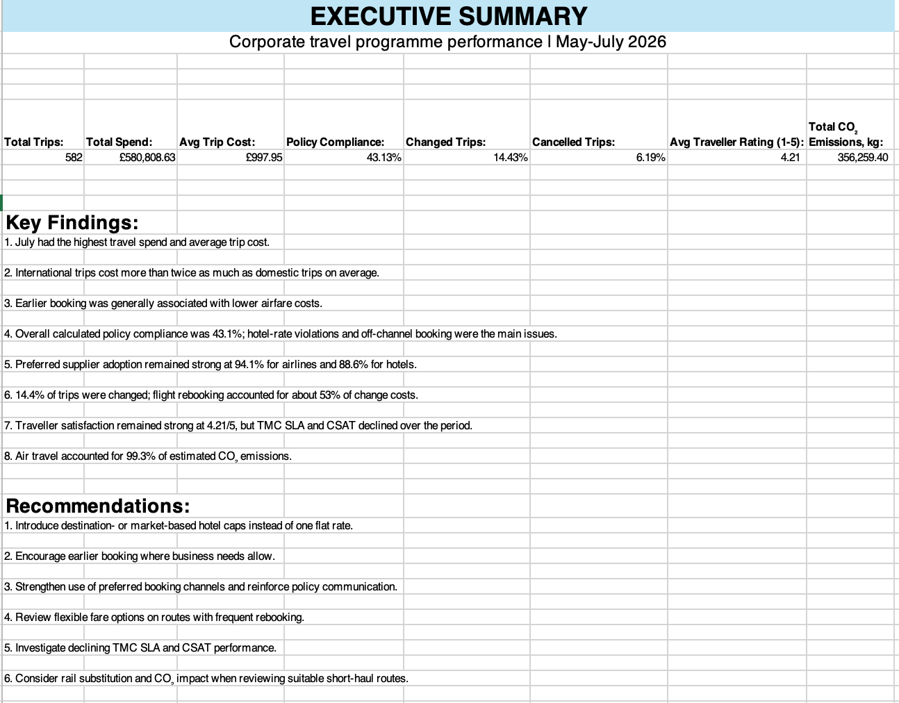
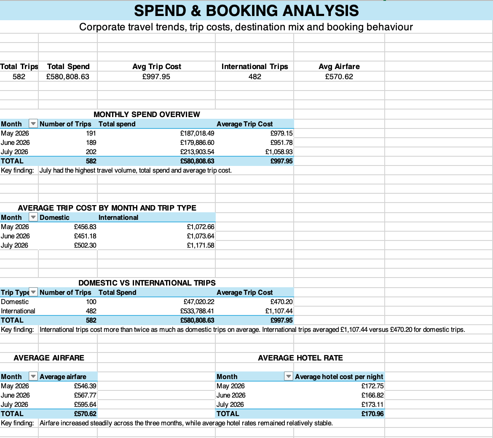

# Corporate Travel Analytics

Portfolio project analysing a synthetic corporate travel programme using Excel, with SQL and Power BI planned as the next stages.

The project explores travel spend, booking behaviour, policy compliance, supplier usage, trip changes and cancellations, traveller feedback, service performance, and sustainability.

## Project Overview

The dataset represents:

- 582 corporate trips
- 160 fictional travellers
- £580,808.63 in final travel spend
- May–July 2026 travel activity
- 100 trip-change events
- 36 cancellations
- 239 traveller feedback responses

All data is synthetic.

Real airline and hotel brand names are used only to make the fictional scenario easier to understand. Preferred-supplier status, commercial relationships, costs, performance metrics, and traveller activity are entirely fictional.

## Business Problem

Corporate travel programmes can lose money through:

- late booking
- off-channel booking
- policy non-compliance
- itinerary changes
- cancellations
- weak preferred-supplier adoption

At the same time, service issues can reduce traveller satisfaction and inefficient travel choices can increase environmental impact.

The analysis aims to identify where these issues occur and suggest practical opportunities for cost, policy, service, and process improvement.

## Business Questions

The project investigates:

1. Where is travel spend concentrated?
2. Which booking behaviours are associated with higher costs?
3. How does booking lead time relate to airfare?
4. What are the main drivers of policy non-compliance?
5. How strongly are preferred airline and hotel suppliers being used?
6. What is the financial impact of trip changes and cancellations?
7. How are service providers performing against their targets?
8. What does traveller feedback indicate about the travel experience?
9. Which routes and travel modes contribute most to estimated CO₂ emissions?

## Tools

### Excel

The Excel stage includes:

- data validation and quality checks
- PivotTables
- XLOOKUP
- VLOOKUP
- COUNTIF / COUNTIFS
- SUMIF / SUMIFS
- calculated compliance fields
- booking lead-time analysis
- spend and cost analysis
- supplier analysis
- change and cancellation analysis
- traveller feedback analysis
- service KPI analysis
- sustainability analysis
- executive summary

### Planned Next Stages

- SQL for relational analysis and querying
- Power BI for dashboard development and data visualisation

## Data Preparation and Validation

Before analysis, the trip-level dataset was checked for issues including:

- missing required values
- invalid date relationships
- booking lead-time inconsistencies
- original trip cost reconciliation
- final trip cost reconciliation
- changed and cancelled flags
- categorical values
- feedback values

Validation fields were created to return `OK` or `Check`, making potential data-quality problems easier to identify.

The working dataset was also enriched using lookup functions to connect trip-level records with supplier reference tables.

Example:

```excel
=IF(T3="","",XLOOKUP(T3,Airlines!A:A,Airlines!B:B,"Not Found"))
```

This formula takes the airline ID from a trip, searches for the same ID in the Airlines reference table, and returns the corresponding airline name.

## Excel Functions Used

### XLOOKUP

Used to retrieve related supplier information from reference tables.

Example business question:

> Which airline name corresponds to the airline ID on a trip?

### VLOOKUP

Used as an alternative lookup method to retrieve hotel information.

Example business question:

> Which hotel name corresponds to the hotel ID on a trip?

### COUNTIF / COUNTIFS

Used to count records meeting one or more conditions.

Example:

```excel
=COUNTIFS(
    Trips_Workbook!J:J,
    "2026-07",
    Trips_Workbook!S:S,
    "TMC Assisted"
)
```

Result: **56 July trips were booked through TMC Assisted.**

### SUMIF / SUMIFS

Used to calculate spend for selected groups.

Example:

```excel
=SUMIFS(
    Trips_Workbook!AI:AI,
    Trips_Workbook!D:D,
    "Technology",
    Trips_Workbook!J:J,
    "2026-06"
)
```

Result: **£28,324.26 was spent on Technology department trips in June.**

## Excel Analysis Preview

### Executive Summary



The Executive Summary brings together the main programme KPIs, findings, and recommended actions in one view.

### Spend & Booking Analysis



The Spend & Booking analysis explores monthly spend, trip volume, domestic versus international travel, airfare, hotel rates, and booking behaviour.

## Key Findings

### Spend and Booking Behaviour

- Total final travel spend was **£580,808.63** across **582 trips**.
- Average trip cost was **£997.95**.
- July had the highest trip volume, total spend, and average trip cost.
- International trips averaged approximately **£1,107**, compared with approximately **£470** for domestic trips.
- Earlier booking was generally associated with lower airfare costs.
- Trips booked 31+ days in advance had the lowest average airfare among the analysed lead-time groups.

The relationship between booking lead time and airfare should be interpreted as an association rather than proof of causation, as destination, route mix, and demand can also influence ticket prices.

### Policy Compliance

A transparent rule-based compliance calculation was created using factors including:

- booking channel
- hotel rate
- hotel supplier status
- airline supplier status
- travel class

Calculated overall policy compliance was **43.13%**.

Main compliance issues included:

- **187 hotel-rate violations**
- **101 off-channel trips**

Preferred supplier adoption remained relatively strong:

- Airlines: **94.06%**
- Hotels: **88.63%**

### Changes and Cancellations

- **84 trips** were changed, representing **14.43%** of all trips.
- These trips generated **100 individual change events**.
- Total change cost was **£9,406.58**.
- Flight rebooking accounted for approximately **53% of total change costs**.

Cancellations:

- **36 trips** were cancelled.
- Cancellation rate: **6.19%**
- Cancellation fees: **£3,028**
- Refunds recovered: **£26,195.66**

### Traveller Feedback

- Feedback responses: **239**
- Response rate: **41.07%**
- Average overall trip rating: **4.21 / 5**
- Average booking experience rating: **4.13 / 5**
- Average travel support rating: **4.07 / 5**
- Average supplier rating: **4.17 / 5**

Approximately **80.3%** of respondents rated their trip either 4 or 5.

### Service Performance

The analysis compared actual service performance with fictional monthly targets.

Notable trends included:

- TMC SLA declined from **95% in May to 91% in July**
- TMC CSAT declined from **4.2 to 3.8**
- Online Booking Tool availability remained close to target
- Online Booking Tool adoption remained below the **85% target**, although it recovered to **84% in July**

### Sustainability

Estimated total travel emissions were **356,259.4 kg CO₂**.

Travel mode contribution:

- Air: **99.33%**
- Rail: **0.67%**

New York generated the highest total destination-level emissions.

Long-haul destinations generated high emissions even with relatively low trip volumes, while high-frequency European routes such as Dublin and Amsterdam also contributed materially.

## Recommendations

Based on the analysis:

1. Introduce destination- or market-based hotel caps rather than one flat rate.
2. Encourage earlier booking where business requirements allow.
3. Strengthen preferred booking-channel adoption and policy communication.
4. Review flexible fare options on routes with frequent rebooking.
5. Improve monitoring of cancellations, unused tickets, and outstanding refunds.
6. Investigate the decline in TMC SLA and CSAT performance.
7. Monitor traveller feedback alongside operational service KPIs.
8. Consider rail substitution for suitable short-haul routes.
9. Include CO₂ impact alongside cost and trip volume when reviewing travel patterns.

## Workbook Structure

The Excel workbook contains:

- `README`
- `Executive Summary`
- `Policy Reference`
- `Trips_Raw`
- `Trips_Workbook`
- `Calculations`
- `Spend & Booking Analysis`
- `Compliance Analysis`
- `Changes_Cancellations_Analysis`
- `Feedback & SP Analysis`
- `Service Performance`
- `Sustainability_Analysis`
- `Travellers`
- `Airlines`
- `Hotels`
- `Trip Changes`
- `Trip Cancellations`
- `Traveller Feedback`

## Skills Demonstrated

This project demonstrates practical experience with:

- data cleaning and validation
- exploratory data analysis
- Excel PivotTables
- XLOOKUP and VLOOKUP
- COUNTIF / COUNTIFS
- SUMIF / SUMIFS
- KPI development
- business-focused analysis
- identifying anomalies and discrepancies
- translating analysis into recommendations
- communicating findings in plain business language

## Project Structure

```text
corporate-travel-analytics/
├── README.md
├── excel/
│   └── corporate_travel_analytics.xlsx
├── dashboard/
│   └── screenshots/
│       ├── executive_summary.png
│       └── spend_booking_analysis.png
├── data/
└── sql/
```

## Project Status

**Excel analysis: completed**

Next stages:

- SQL analysis
- Power BI dashboard
- final portfolio visualisation and documentation